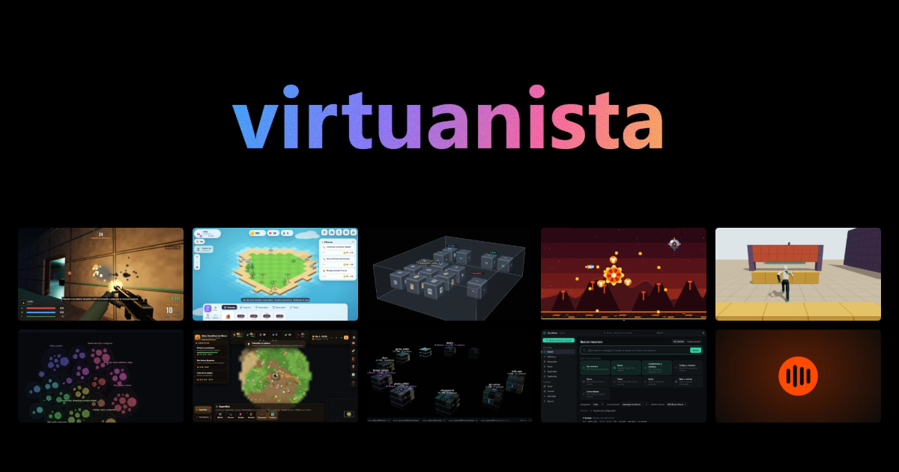

<a href="README.md">Español</a> · <b>English</b>

# virtuanista's portfolio

Website with the public projects of [virtuanista](https://github.com/virtuanista): **[virtuanista.github.io](https://virtuanista.github.io/)**.

A board with filters by type, a table, pending work, activity and a page for each project. No dependencies.

- **Content:** `src/content.mjs` in Spanish (default) and `src/content.en.mjs` in English (`/en/`).
- **Data:** `node scripts/build.mjs --sync` reads GitHub (dates, commits, languages, CI and releases) and generates `dist/`.
- **Profile:** the same command generates `dist-profile/README.md` and the figures as SVG (light and dark).
- **Covers:** `img/t/<id>.webp`, 800×450, one per project.
- **Publishing:** GitHub Actions, on every push and on Mondays, without creating commits.

## License

Code under [MIT](LICENSE). The screenshots show projects with their own licenses and credits.

	Repository made by <a href="https://github.com/virtuanista" target="_blank">virtu 🎣</a>

	

	Copyright &copy; 2026

	

