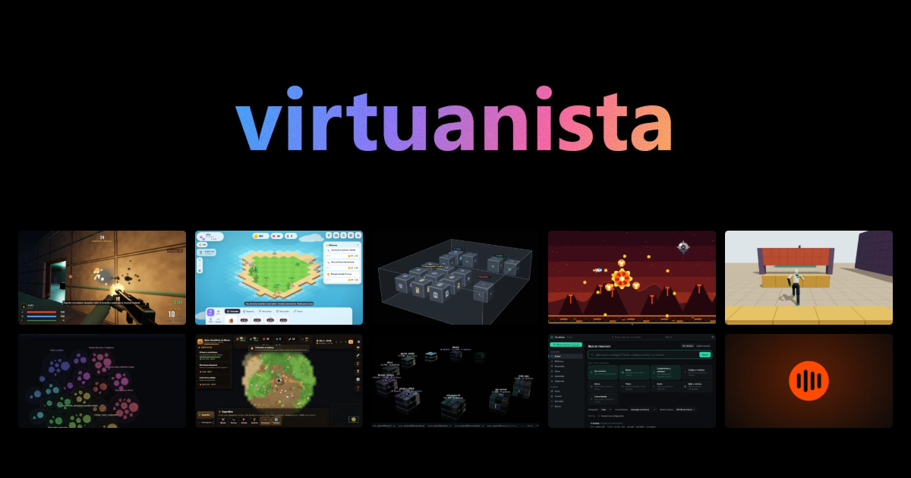

<b>Español</b> · <a href="README.en.md">English</a>

# Portfolio de virtuanista

Web con los proyectos públicos de [virtuanista](https://github.com/virtuanista): **[virtuanista.github.io](https://virtuanista.github.io/)**.

Tablero con filtros por tipo, tabla, pendientes, actividad y una ficha por proyecto. Sin dependencias.

- **Contenido:** `src/content.mjs` en español (por defecto) y `src/content.en.mjs` en inglés (`/en/`).
- **Datos:** `node scripts/build.mjs --sync` lee GitHub (fechas, commits, lenguajes, CI y versiones) y genera `dist/`.
- **Perfil:** el mismo comando genera `dist-profile/README.md` y las cifras en SVG (claro y oscuro).
- **Portadas:** `img/t/<id>.webp`, 800×450, una por proyecto.
- **Publicación:** GitHub Actions, en cada push y los lunes, sin crear commits.

## Licencia

Código bajo [MIT](LICENSE). Las capturas muestran proyectos con sus propias licencias y créditos.

	Repositorio generado por <a href="https://github.com/virtuanista" target="_blank">virtu 🎣</a>

	

	Copyright &copy; 2026

	

